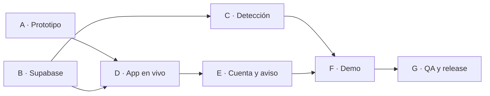

# Planes de desarrollo del MVP (OpenSpec)

Los 7 planes viven como cambios de OpenSpec en [`openspec/changes/`](../../openspec/changes/). Cada uno tiene `proposal.md` (por qué y alcance), `design.md` (cómo y decisiones), `specs/` (comportamiento verificable) y `tasks.md` (checklist que el agente marca). Todo sale de las notas de Obsidian `Capstone/Cronograma` (04, 05, 07, 09, 10, 11, 12) y del guion del pitch.

| Plan | Cambio | Qué deja listo | Hitos | Fecha | Sugerido para |
|---|---|---|---|---|---|
| A | [`a-integrate-mobile-prototype`](../../openspec/changes/a-integrate-mobile-prototype/) | PR #1 integrado, identidad v1.1, 3 estados, modos conductor/admin | 06, 12 | Jue 12 | Juan |
| B | [`b-setup-supabase-schema`](../../openspec/changes/b-setup-supabase-schema/) | Supabase con DER v1.1, reglas, RLS, RPC, Realtime y seed | 09, 10, 11, 12 | Jue 12 | Mao |
| C | [`c-add-detection-service`](../../openspec/changes/c-add-detection-service/) | Servicio de detección YOLO / diff en Docker | 12, 13 | Vie 13 | Felipe |
| D | [`d-connect-app-realtime`](../../openspec/changes/d-connect-app-realtime/) | App leyendo Supabase en vivo, ocupación y filtro | 13 | Vie 13 | Juan |
| E | [`e-add-auth-favorites-alerts`](../../openspec/changes/e-add-auth-favorites-alerts/) | Cuenta opcional, favoritos y aviso de puesto libre | 13, 14 | Sáb 14 | Mao / Juan |
| F | [`f-prepare-pitch-demo`](../../openspec/changes/f-prepare-pitch-demo/) | Calibración, reinicio y respaldo de la demo con maqueta | 18 | Sáb 14 – Lun 16 | Felipe / Mafe |
| G | [`g-qa-and-release`](../../openspec/changes/g-qa-and-release/) | Mediciones, seguridad, privacidad, respaldo y release | 15–17, 19–22 | Dom 15 – Lun 16 | Todos |

## Orden y dependencias

A y B van en paralelo el jueves; C y D en paralelo el viernes. Demo interna el sáb 14, congelamiento el dom 15 (desde ahí solo ramas `fix/`), entrega el mar 17.

## Flujo por plan

1. Desde `develop` actualizado: `git switch -c feature/<id-del-cambio>`.
2. En Claude Code: `/openspec-apply-change <id-del-cambio>`. El agente lee proposal, design, specs y tasks, implementa tarea por tarea y marca cada `- [ ]` al verificarla.
3. Si una tarea choca con el diseño o pide algo fuera del Must, el agente se detiene y pregunta (`/openspec-update-change` para ajustar el plan).
4. `openspec validate <id> --strict` y revisión con `code-review-graph`.
5. PR a `develop`; nunca push directo a `main` ni `develop`.
6. Tras el merge: `openspec archive <id>` (pasa las specs a `openspec/specs/`) y un resumen corto a Mao para actualizar las notas de Obsidian y el Excel.

## Requisitos en cada equipo

- OpenSpec CLI: `npm i -g @fission-ai/openspec` (los comandos `/openspec-*` ya están en `.claude/skills/`).
- Supabase CLI y Docker (B, C, E, G), Node con Expo Go en el celular (A, D, E), Python 3.11 (C, F).
- Llaves de la demo por canal privado, nunca en Git.
